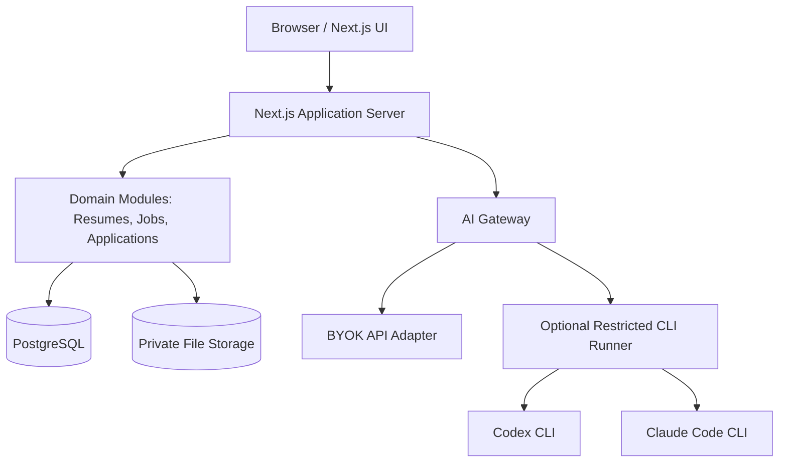

# Lokr

**A self-hosted workspace for managing your job search — from resumes and job listings to applications and AI-assisted interview preparation.**

Lokr is an open-source-oriented **job application manager** designed to bring the job search process into one private, organized workspace. Instead of juggling spreadsheets, multiple resume files, job boards, and disconnected AI chats, you can manage the entire application journey in one place.

> **Project status: MVP v0.1 — under development.** This repository currently provides an **engineering blueprint** (product requirements, architecture, technical specifications, and coding-agent tasks), **not a runnable application**. The included Docker Compose file is a placeholder until the application bootstrap is implemented.

## Why Lokr?

Searching for a job involves more than submitting applications. You need to keep track of opportunities, customize resumes for different roles, prepare for interviews, and remember where each application stands.

Lokr aims to make that workflow easier while keeping you in control:

- **Self-hosted first:** Run Lokr on your own machine or infrastructure using Docker Compose.
- **Single-user MVP:** One account owner per installation; data ownership is modeled explicitly for future extensibility.
- **Bring your own AI (BYOK):** Configure supported AI APIs with your own key, or connect compatible officially supported AI CLI tools.
- **Privacy-focused:** Store resumes and application records locally. Sending data to external AI providers must be explicit and transparent.
- **Human-reviewed output:** AI helps analyze and draft content, but you remain responsible for reviewing resumes and submitting applications.

## Planned MVP Features

| Feature | What it will do |
| --- | --- |
| **Resume Manager** | Upload PDF/DOCX resumes, extract and review text, and manage resume versions. |
| **Job Manager** | Save job opportunities, company details, source links, and job descriptions. |
| **Application Tracker** | Track stages, dates, notes, next steps, and application history. |
| **AI Resume Matching** | Compare a resume against a job description and explain strengths, relevant evidence, and skill gaps. |
| **Tailored Resumes** | Generate a job-specific draft that users can review, edit, and export as PDF. |
| **Interview Preparation** | Generate role-specific questions, talking points, and text-based answer frameworks. |
| **Dashboard** | See application status counts, recent activity, and an overview of the job search. |
| **AI Settings** | Configure connections, select a provider/model where supported, test connectivity, and understand errors. |

> **Important:** Resume-match ratings are explainable **heuristics**, not official applicant tracking system (ATS) scores or promises of interview success. Lokr must not invent qualifications, experience, or achievements when tailoring a resume.

### Core Workflow


## AI Integrations

Lokr is designed around a **provider-agnostic AI Gateway**. Resume matching, resume tailoring, and interview preparation share a consistent task contract instead of depending directly on any individual AI provider.

| Connection type | Examples | MVP plan |
| --- | --- | --- |
| **AI API (BYOK)** | Supported providers using user-owned API keys | Primary integration path |
| **AI CLI / subscription** | Codex CLI, Claude Code CLI | Proof of concept through a restricted, isolated AI Runner |
| **Additional CLI tools** | Kilo Code and other compatible tools | Evaluate after the adapter contract is stable |
| **Local inference** | Ollama | Potential follow-up, not guaranteed for the first release |

**A subscription is not the same as API access.** Whether a CLI-backed subscription can be used depends on its official supported interfaces and terms. Lokr will not scrape session cookies, extract authentication tokens, or impersonate first-party clients.

The optional **AI Runner** will execute only explicitly supported CLI integrations in a restricted environment, separate from the web application. Non-AI functionality and API-based connections must remain usable without this runner.

See [AI Integration Specification](docs/specs/AI_INTEGRATION.md), [AI Connectivity ADR](docs/adr/002-ai-connectivity.md), and [Security Model](docs/SECURITY.md).

## Technology Stack

The MVP stack is locked in [ADR-000](docs/adr/000-stack-accepted.md).

| Layer | Technology |
| --- | --- |
| Web application | Next.js App Router, React, TypeScript (strict mode) |
| Styling | Tailwind CSS |
| Application architecture | Modular monolith, server-side Node.js |
| Database | PostgreSQL |
| ORM and migrations | Drizzle ORM, Drizzle Kit |
| Validation | Zod |
| Document storage | Private local filesystem with persistent storage |
| AI | Provider-agnostic AI Gateway; optional isolated CLI Runner |
| Package manager | pnpm |
| Tests | Vitest, Playwright |
| Deployment | Docker Compose |
| CI | GitHub Actions |

## MVP Architecture



**Planned repository structure** (some directories are not implemented yet):

```text
lokr/
├── apps/
│   ├── web/                    # Next.js UI and server (planned)
│   └── ai-runner/              # Optional isolated CLI execution service (planned)
├── packages/
│   ├── core/                   # Domain and application logic
│   ├── database/               # Drizzle schemas, migrations, repositories
│   ├── ai/                     # AI Gateway and provider adapters
│   └── storage/                # Private document storage adapter
├── deploy/self-hosted/         # Docker Compose configuration
├── docs/                       # PRD, architecture, specs, ADRs, security
├── agent/tasks/                # Incremental coding-agent backlog
├── AGENTS.md                   # Instructions for AI coding agents
└── START_HERE_AGENT_PROMPT.md # Initial coding-agent prompt
```

Read the [Architecture](docs/ARCHITECTURE.md), [Data Model](docs/specs/DATA_MODEL.md), and [API Contract](docs/specs/API_CONTRACT.md) for implementation details.

## Roadmap

- [x] Define the self-hosted, single-user MVP scope.
- [x] Lock the technology stack and modular-monolith approach.
- [x] Document the AI Gateway contract and AI Runner security constraints.
- [ ] **Foundation:** Scaffold Next.js, PostgreSQL/Drizzle, Docker Compose, local authentication, and CI.
- [ ] **Core workflow:** Implement resume management, saved jobs, application tracking, and dashboard.
- [ ] **AI API:** Implement BYOK, explainable resume matching, and robust error handling.
- [ ] **CLI proof of concept:** Validate Codex/Claude Code compatibility, execution isolation, and provider terms.
- [ ] **AI features:** Build reviewable tailored resumes, PDF export, and interview preparation.
- [ ] **Release readiness:** Complete end-to-end tests, backup/restore guidance, setup documentation, and security review.

See the [Implementation Plan](docs/implementation/PLAN.md) and [Agent Task Backlog](agent/tasks/README.md).

## Getting Started

> **The application is not runnable yet.** The following command validates the planning files only; it does not start Lokr.

For the blueprint stage, Python 3 is sufficient. A supported Node.js LTS version, pnpm, and Docker will be required after bootstrap.

```bash
# After cloning the repository or extracting the project archive
python3 scripts/check-blueprint.py
```

### Building Lokr with a Coding Agent

1. Open the repository in Codex, Claude Code, or another coding agent.
2. Ask it to read [`AGENTS.md`](AGENTS.md), [`START_HERE_AGENT_PROMPT.md`](START_HERE_AGENT_PROMPT.md), the PRD, and accepted ADRs.
3. Start with **LOK-002 (application bootstrap)** using the [Stack Implementation Checklist](docs/implementation/STACK_IMPLEMENTATION.md).
4. Implement one task at a time, run the relevant checks, and review changes before proceeding.

Once bootstrap is complete, this section will be updated with **verified** installation instructions, including environment configuration, database migrations, `docker compose up`, and backup/restore steps.

## Out of Scope for MVP v0.1

The first version does **not** include hosted SaaS, billing, managed AI credits, team accounts, automatic job submissions, browser extensions, automated job scraping, email synchronization, or camera/microphone-based mock interviews.

The goal is to deliver one reliable, end-to-end application-management workflow before expanding the feature set.

## Security and Privacy

Resumes, job descriptions, and AI credentials may contain sensitive information. The implementation must enforce owner authentication, secure uploads, private file storage, encrypted API keys at rest, secret redaction in logs, and least-privilege AI Runner execution. Users should understand when resume content is sent to an external AI provider.

Review the [Security and Privacy Threat Model](docs/SECURITY.md) before implementing uploads or AI integrations. **Never commit** `.env` files, personal resumes, API keys, or CLI authentication tokens.

## Contributing

Lokr is currently in the foundation stage. Feedback on product requirements, user flows, accessibility, security, and AI adapter design is welcome.

Before implementing changes, review [`AGENTS.md`](AGENTS.md), the relevant specification, and the accepted architecture decisions. Keep contributions focused, testable, and consistent with the MVP scope.

**Open decisions:** resume editing strategy ([ADR-004](docs/adr/004-resume-workflow.md)) and open-source license ([ADR-003](docs/adr/003-license-pending.md)).

## License

**Not selected yet.** Lokr is intended to become an open-source project, but this repository does **not** grant an open-source license until the project owner selects a license and adds an appropriate `LICENSE` file. Please do not assume redistribution or reuse rights before that happens.

---

**Lokr** — *Track applications. Tailor resumes. Prepare with AI. Stay in control.*
