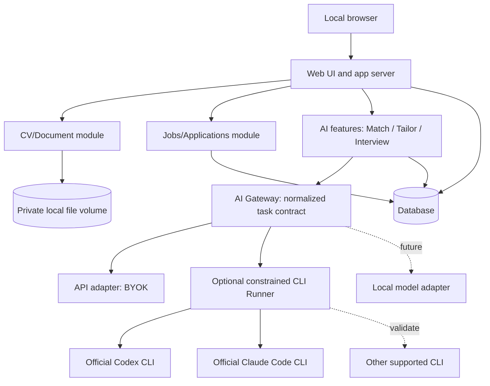

# Lokr MVP architecture — accepted stack

## Context
Single-user self-hosted **Next.js App Router + TypeScript modular monolith**, with **PostgreSQL + Drizzle ORM**, private local filesystem and optional separate restricted CLI AI Runner. UI and HTTP boundaries live in `apps/web`; business logic lives in framework-independent packages.

## Stack and repository boundaries
- `apps/web`: Next.js App Router, React, Tailwind CSS, thin route handlers/server actions and authenticated UI.
- `packages/core`: domain entities, pure business logic, application use cases; no dependency on Next.js.
- `packages/database`: Drizzle schema, Postgres connection, migrations, repositories.
- `packages/ai`: typed gateway tasks, adapters, response validation, security constraints.
- `packages/storage`: private local filesystem adapter and interfaces.
- `apps/ai-runner` (later optional): restricted CLI process/container, separate from web runtime and disabled by default.
- `deploy/self-hosted`: Compose app + Postgres, volume persistence, optional runner profile in later task.

Use Node.js server runtime for filesystem, CLI IPC and database connectivity, never an Edge runtime for these paths. Use Zod validation at all external boundaries; SSR/server-only code must keep provider secrets off the client.

## Modules
- `identity`: owner login, session and authorization. Single owner initially, `user_id` in domain records.
- `resumes`: original uploads, extracted text, versions, user corrections.
- `jobs`: saved job and companies.
- `applications`: status transition, notes, events.
- `ai-gateway`: provider-independent task interface; schema validation and deterministic score math.
- `ai-adapters`: official API adapters and CLI adapter clients.
- `ai-runner`: **separate process/container** with restricted commands, not a general shell/agent.
- `documents`: trusted extraction, export, and file lifecycle.
- `dashboard`: queries and charts based on local data.

## Runtime and trust boundaries
1. Browser -> server: authenticated and authorized; no provider secret in browser.
2. Server -> external API: only on user-triggered invocation; announce disclosure and provider.
3. Server -> CLI Runner: local authenticated IPC; send minimum necessary sanitized prompt and files; runner returns only bounded, parsed result.
4. Runner -> provider CLI: use official installed tooling/auth; no token harvesting. Treat CLI subscription support as provider/tool specific and subject to TOS/technical validation.
5. Server -> local storage: randomized opaque filename, path traversal prevention, ownership checks.

## Recommended flow for long AI tasks
`create task` -> `pending` -> worker/runner `running` -> output schema validate -> `completed/failed/cancelled`. Persist state and safe error category; no raw secrets and no unbounded transcript logging. An in-process background queue is acceptable for initial implementation if resumability is addressed.

## Deployment target
- At minimum an app service and persistent database/file volumes; add separate AI Runner only if CLI integration enabled.
- Never mount `/var/run/docker.sock` into app/runner.
- The **Compose YAML in this package is a placeholder, not a deployed application** until LOK-002 builds the app and deployment configuration.

## Compatibility principle
All AI features call `runTask(task, context, connection)` and never call `codex`, `claude` or a specific provider directly. See `docs/specs/AI_INTEGRATION.md`.
